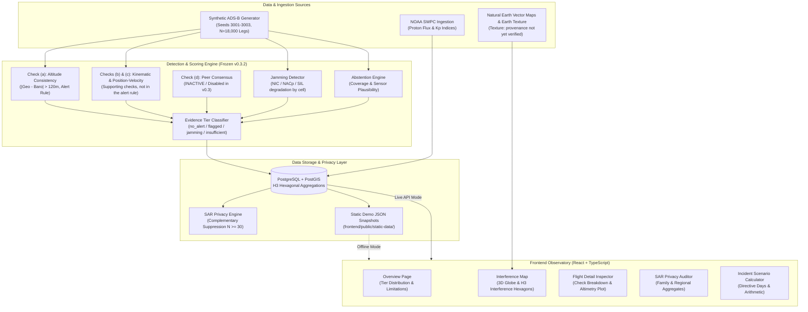

# AeroTrust: Avionics Telemetry Integrity Observatory

**Evaluation Tag**: `v0.3.2-verified` | **App Tag**: `v1.0.5-demo`

> **Disclaimer**: Independent personal project, not affiliated with or endorsed by Airbus. Uses public information only.

AeroTrust is an avionics data-integrity observatory designed to evaluate aircraft ADS-B telemetry against GNSS spoofing, interference, and atmospheric radiation anomalies in a single unified interface. Operating under frozen verification benchmarks on synthetic flight trajectories, it pairs physics-based altimetry consistency checks with an unsupervised abstention engine, classifying telemetry into four standardized evidence tiers (`no_alert`, `flagged_altitude_inconsistency`, `jamming_degraded`, `insufficient`). It features an aggregate Silent Acceptance Rate (SAR) auditor, geographic H3 interference mapping, and an Incident Scenario Calculator for aviation airworthiness directives.

> **SYNTHETIC DATASET NOTICE**: All operational flight paths, telemetry points, and threat injections evaluated in AeroTrust are generated synthetically. Performance benchmarks reflect simulated ADS-B disruptions and do not represent operational airline flight safety records.

> **Evaluation Populations & Denominators**:
> - **Populations**: `clean` = neither spoofed nor jammed; `non-spoofed` = clean + jam-only.
> - **Benchmark Dataset (Pooled Seeds 3001–3003, N=18,000 Scheduled Legs)**: non-spoofed legs 12,986 (of which clean-only legs: 11,123; jam-only legs: 1,863); spoofed legs: 5,014.
> - **Clean FPR Denominator**: The 1.17% clean false-positive rate is evaluated over the 11,123 clean-only legs (130 / 11,123).
> - **Per-Seed Precision Denominators**: Evaluated over all flagged legs (TP + FP): Seed 3001: 445 (401/445 = 90.1%); Seed 3002: 526 (482/526 = 91.6%); Seed 3003: 514 (470/514 = 91.4%).

---

## What This Can and Cannot Do

### What this CAN do:
* **Altimetry Consistency Verification**: Evaluates geometric (GNSS) altitude vs. barometric altimetry residuals along flight trajectories (Check a), flagging discrepancies exceeding the 120.0 m threshold.
* **Jamming Environment Mapping**: Aggregates multi-aircraft ADS-B radio-frequency degradation indicators (NIC, NACp, SIL drops) into spatial H3 hexagons to map interference corridors.
* **Evidence-Tiered Scoring**: Classifies telemetry into four strict operational tiers (`no_alert`, `flagged_altitude_inconsistency`, `jamming_degraded`, `insufficient`) without presenting uncalibrated model probabilities as ground truth.
* **Privacy-Preserving SAR Auditing**: Reports Silent Acceptance Rate ($\hat{\text{SAR}}$) metrics across aircraft families and geographic regions under strict minimum cohort thresholds ($N \ge 30$) with cell suppression.
* Scenario arithmetic over public cases: aircraft-days held; money appears only if you enter a value.

### What this CANNOT do:
* **Detect Horizontal / Lateral Spoofing**: Produces **0.0% recall** on lateral track offsets or waypoint substitutions, as only vertical altimetry consistency is active in v0.3.
* **Guarantee Real-World Air Traffic Safety**: All benchmarks are conducted on synthetic datasets; detector thresholds have not been calibrated on certified airline flight data recorder (FDR) streams.
* **Execute Multi-Aircraft Peer Consensus**: Multi-aircraft consensus (Check d) is disabled in v0.3 due to self-referential graph dependencies and does not contribute to detection.
* **Provide Reliable Cockpit Warnings in Peacetime Airspace**: In normal low-threat airspaces (0.01% base rate), precision drops to **0.2%** due to background barometric false alarms (~117 false alarms per 10,000 clean flights); independent sensor corroboration is required.
* **Prove Radiation Causality**: Space weather indices (NOAA proton flux, Kp) serve strictly as illustrative exposure context; they do not establish physical causality for avionics computer upsets.
* **Provide Certified Incident Financial Valuations**: Incident Scenario Calculator cases are illustrative benchmarks; all seeded presets require verified primary regulatory documents.

---

## Quickstart in Three Commands

```bash
# 1. Launch self-contained static demo (runs 100% offline with zero database dependency)
npm run demo

# 2. Run backend test suite (73 tests covering detectors, privacy, and integrity)
pytest backend/tests/ -q

# 3. Run frontend test suite (21 Vitest unit and accessibility tests)
npm test
```

To build a standalone production bundle deployable to any free static host (GitHub Pages, Netlify, Vercel, S3):
```bash
npm run build:static
# Output generated in frontend/dist/
```

---

## Architecture



---

## Claims and Evidence

| Claim | Reported value (synthetic data) | Unit and seeds | Source table |
| :--- | :--- | :--- | :--- |
| **Recall on all spoofed legs (pooled)** | 26.98% ([25.77%, 28.23%]) | Scheduled flight legs, pooled seeds 3001–3003 (N = 5,014 spoofed legs / 18,000 legs; non-spoofed legs 12,986, of which clean-only legs: 11,123) | [`docs/generated/base_rate_honesty_table.md`](file:///c:/Users/ASus/Desktop/AeroTrust/docs/generated/base_rate_honesty_table.md) & [`leg_level_metrics.md`](file:///c:/Users/ASus/Desktop/AeroTrust/docs/generated/leg_level_metrics.md) |
| **Recall by attack type** | Altitude offset: 37.7%–51.6%; Combined: 34.0%–43.5%; Horizontal offset: 0.0%; Horizontal drift: 0.0% (Note: 40.8% is an earlier README figure that is no longer reported) | Scheduled flight legs per attack subtype, seeds 3001, 3002, 3003 | [`docs/generated/event_type_honesty_table.md`](file:///c:/Users/ASus/Desktop/AeroTrust/docs/generated/event_type_honesty_table.md) |
| **Observed leg-level precision per seed** | Seed 3001: 90.1% (TP=401, FP=44, denom=445); Seed 3002: 91.6% (TP=482, FP=44, denom=526); Seed 3003: 91.4% (TP=470, FP=44, denom=514) at benchmark attack share 26.6%–29.4% (1,595–1,763 spoofed legs / 6,001 legs per seed) | Scheduled flight legs per seed, unpooled (denominator: total flagged legs TP + FP) | [`docs/generated/leg_level_metrics.md`](file:///c:/Users/ASus/Desktop/AeroTrust/docs/generated/leg_level_metrics.md) |
| **Expected precision at assumed threat prevalence (derived, assumed prevalence)** | p=0.01%: 0.2% ([0.2%, 0.3%]); p=0.1%: 2.3% ([1.8%, 2.8%]); p=1%: 18.9% ([15.8%, 22.4%]); p=5%: 54.9% ([49.5%, 60.1%]); p=17.47%: 83.0% ([79.7%, 85.8%]) (Derived via Bayes rule from pooled TPR 26.98% and clean FPR 1.17%; 83.0% belongs here) | Derived via Bayes rule over scheduled flight legs (pooled seeds 3001–3003) | [`docs/generated/base_rate_honesty_table.md`](file:///c:/Users/ASus/Desktop/AeroTrust/docs/generated/base_rate_honesty_table.md) |
| **Clean false positives per seed (v0.3.2 reproduced counts)** | 44, 44, 44 per seed (superseded '42 to 52' range removed). Breakdown: Seed 3001: 35 baro drift, 8 boundary truncation, 1 jamming; Seed 3002: 35 baro drift, 8 boundary truncation, 1 jamming; Seed 3003: 36 baro drift, 8 boundary truncation, 0 jamming | Clean scheduled flight legs per seed (TN: 4,193, 4,361, 4,300 across 6,001 legs per seed; clean FPR 1.17% denominator: 11,123 clean-only legs) | [`docs/generated/fp_leg_audit_table.md`](file:///c:/Users/ASus/Desktop/AeroTrust/docs/generated/fp_leg_audit_table.md) |
| **Suppression and inactive/demo capabilities** | SAR suppression: N >= 30 strictly enforced (20/24 regional cells masked); Horizontal recall: 0.0%; Consensus: Inactive (0% contribution, disabled in v0.3); Abstention: Benchmark: 0.0%. Rule-trigger demo: 125/200, which is by construction (demo scenarios were built to trigger rules), not a measured rate. | Regional/family cohorts and demo flights (seeds 3001–3003, demo seed 9999) | [`docs/generated/sar_cell_suppression_table.md`](file:///c:/Users/ASus/Desktop/AeroTrust/docs/generated/sar_cell_suppression_table.md) & [`abstention_demo_table.md`](file:///c:/Users/ASus/Desktop/AeroTrust/docs/generated/abstention_demo_table.md) |

> **Precision at Benchmark Base Rate vs Assumed Prevalences**:
> At the benchmark's own leg-level attack share (about 27 to 29%), the derived and observed precision agree at about 90%. At assumed lower prevalences it falls as shown.
> - Seed 3001 (attack share 29.38%): derived precision = 90.1% (non-spoofed FPR) / 88.9% (clean FPR) vs observed 90.1%
> - Seed 3002 (attack share 26.58%): derived precision = 91.6% (non-spoofed FPR) / 90.7% (clean FPR) vs observed 91.6%
> - Seed 3003 (attack share 27.60%): derived precision = 91.4% (non-spoofed FPR) / 90.0% (clean FPR) vs observed 91.4%
> - Pooled (attack share 27.86%): derived precision = 89.9% (clean FPR)

---

## Known Weaknesses

1. **Altitude-Consistency Only**: The sole active spoofing detector is Check (a), which compares barometric and geometric altitude profiles. Any attack maintaining barometric-geometric synchrony will bypass detection.
2. **0% Horizontal Spoofing Recall**: Lateral offsets, circular waypoint spoofing, and ground-track translation attacks produce zero altimetry deviation and have 0.0% detection recall.
3. **Consensus Inactive**: Check (d) multi-aircraft peer consensus is disabled in v0.3 due to self-referential graph loops; peer corroboration does not contribute to v0.3 detection.
4. **Abstention Exercised Only in Demo**: Commercial airway flight tracks in the benchmark dataset have sufficient point density ($N \ge 68$) and dual sensors, resulting in 0.0% benchmark abstention. Abstention is exercised only in the dedicated rule-trigger demo dataset.
5. **False Alarms Driven by Assumed Barometric-Fault Rate**: The synthetic generator draws random barometric bias on 2% of points ($U(60, 180)\text{ m}$), causing ~35 false alarms per 3,650 clean legs whenever bias exceeds the 120.0 m threshold.
6. **Radiation Tables Illustrative**: Solar proton flux and geomagnetic storm data represent environmental background exposure context only; no physical causal link to flight-control software anomalies is claimed.
7. **All Data Synthetic**: All flights, tracks, and interference scenarios derive from synthetic simulation models; no operational commercial airline records were used.
8. **Three Incident Cases Awaiting Source Verification**: Presets for the A320 solar incident, A320 panel recall, and A330neo assembly cases require verified primary regulatory documents and currently display "primary source missing" in red with "unchecked" status.

---

## License & Attributions

* **Evaluation Tag**: `v0.3.2-verified` | **App Tag**: `v1.0.5-demo`
* **Disclaimer**: Independent personal project, not affiliated with or endorsed by Airbus. Uses public information only.
* **License**: [MIT License](file:///c:/Users/ASus/Desktop/AeroTrust/LICENSE)
* **Attributions**: Full catalog of public datasets, textures, and open-source libraries available in [`docs/ATTRIBUTIONS.md`](file:///c:/Users/ASus/Desktop/AeroTrust/docs/ATTRIBUTIONS.md).
