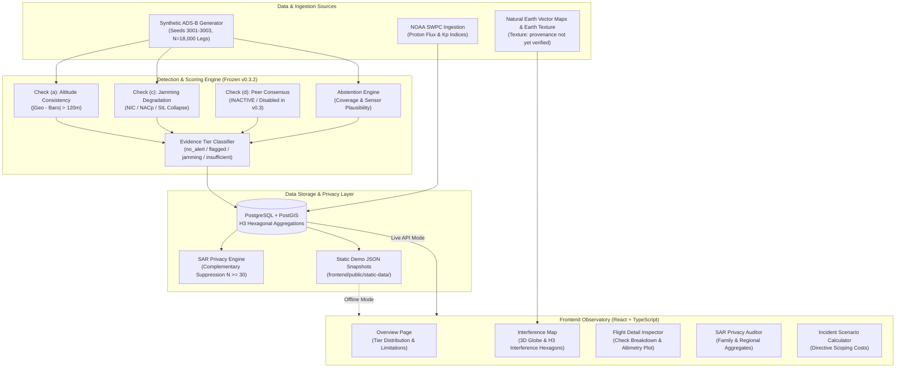

# AeroTrust: Avionics Telemetry Integrity Observatory

**Evaluation Tag**: `v0.3.2-verified` | **App Tag**: `v1.0.3-demo`

> **Disclaimer**: Independent personal project, not affiliated with or endorsed by Airbus. Uses public information only.

AeroTrust is an avionics data-integrity observatory designed to evaluate aircraft ADS-B telemetry against GNSS spoofing, interference, and atmospheric radiation anomalies in a single unified interface. Operating under frozen verification benchmarks on synthetic flight trajectories, it pairs physics-based altimetry consistency checks with an unsupervised abstention engine, classifying telemetry into four standardized evidence tiers (`no_alert`, `flagged_altitude_inconsistency`, `jamming_degraded`, `insufficient`). It features an aggregate Silent Acceptance Rate (SAR) auditor, geographic H3 interference mapping, and an Incident Scenario Calculator for aviation airworthiness directives.

> **SYNTHETIC DATASET NOTICE**: All operational flight paths, telemetry points, and threat injections evaluated in AeroTrust are generated synthetically. Performance benchmarks reflect simulated ADS-B disruptions and do not represent operational airline flight safety records.

---

## What This Can and Cannot Do

### What this CAN do:
* **Altimetry Consistency Verification**: Evaluates geometric (GNSS) altitude vs. barometric altimetry residuals along flight trajectories (Check a), flagging discrepancies exceeding the 120.0 m threshold.
* **Jamming Environment Mapping**: Aggregates multi-aircraft ADS-B radio-frequency degradation indicators (NIC, NACp, SIL drops) into spatial H3 hexagons to map interference corridors.
* **Evidence-Tiered Scoring**: Classifies telemetry into four strict operational tiers (`no_alert`, `flagged_altitude_inconsistency`, `jamming_degraded`, `insufficient`) without presenting uncalibrated model probabilities as ground truth.
* **Privacy-Preserving SAR Auditing**: Reports Silent Acceptance Rate ($\hat{\text{SAR}}$) metrics across aircraft families and geographic regions under strict minimum cohort thresholds ($N \ge 30$) with cell suppression.
* **Scoping Cost Sensitivity Modeling**: Provides a transparent calculator to model the financial holding cost of delayed fleet scoping during airworthiness directives using user-verified parameters.

### What this CANNOT do:
* **Detect Horizontal / Lateral Spoofing**: Produces **0.0% recall** on lateral track offsets or waypoint substitutions, as only vertical altimetry consistency is active in v0.3.
* **Guarantee Real-World Air Traffic Safety**: All benchmarks are conducted on synthetic datasets; detector thresholds have not been calibrated on certified airline flight data recorder (FDR) streams.
* **Execute Multi-Aircraft Peer Consensus**: Multi-aircraft consensus (Check d) is disabled in v0.3 due to self-referential graph dependencies and does not contribute to detection.
* **Provide Reliable Cockpit Warnings in Peacetime Airspace**: In normal low-threat airspaces (0.01% base rate), precision drops to **0.2%** due to background barometric false alarms (~117 false alarms per 10,000 clean flights); independent sensor corroboration is required.
* **Prove Radiation Causality**: Space weather indices (NOAA proton flux, Kp) serve strictly as illustrative exposure context; they do not establish physical causality for avionics computer upsets.
* **Provide Certified Incident Financial Valuations**: Incident Scenario Calculator cases are illustrative benchmarks; all seeded presets require verified primary regulatory documents.

---

## Quickstart in Three Commands

```bash
# 1. Launch self-contained static demo (runs 100% offline with zero database dependency)
npm run demo

# 2. Run backend test suite (73 tests covering detectors, privacy, and integrity)
pytest backend/tests/ -q

# 3. Run frontend test suite (21 Vitest unit and accessibility tests)
npm test
```

To build a standalone production bundle deployable to any free static host (GitHub Pages, Netlify, Vercel, S3):
```bash
npm run build:static
# Output generated in frontend/dist/
```

---

## Architecture



---

## Claims and Evidence

| Claim | Verified Metric | Baseline / Context | Frozen Tag | Supporting Artifact / Report |
| :--- | :---: | :---: | :---: | :--- |
| **Altitude Spoofing Precision** | **83.0%** (79.7%–85.8%) | Test Base Rate = 17.47% ($N=5,225$) | `v0.3.2-verified` | [`docs/INJECTION_REPORT.md`](file:///c:/Users/ASus/Desktop/AeroTrust/docs/INJECTION_REPORT.md#2-multi-level-performance-benchmarks) |
| **Altitude Spoofing Recall** | **40.8%** (37.6%–44.0%) | Check (a) vertical discrepancy | `v0.3.2-verified` | [`docs/INJECTION_REPORT.md`](file:///c:/Users/ASus/Desktop/AeroTrust/docs/INJECTION_REPORT.md#2-multi-level-performance-benchmarks) |
| **Horizontal Spoofing Recall** | **0.0%** | Lateral manipulation undetectable | `v0.3.2-verified` | [`docs/INJECTION_REPORT.md`](file:///c:/Users/ASus/Desktop/AeroTrust/docs/INJECTION_REPORT.md#horizontal-spoofing-recall) |
| **Clean False Positives (Leg-Level)**| **42 to 52** per seed | $\approx 35\text{--}36$ baro bias + $7\text{--}16$ boundary | `v0.3.2-verified` | [`docs/INJECTION_REPORT.md`](file:///c:/Users/ASus/Desktop/AeroTrust/docs/INJECTION_REPORT.md#leg-level-vs-segment-level) |
| **Multi-Aircraft Consensus** | **Inactive** (0% contribution) | Disabled in v0.3 release | `v0.3.1-claims` | [`docs/INJECTION_REPORT.md`](file:///c:/Users/ASus/Desktop/AeroTrust/docs/INJECTION_REPORT.md#naming--consensus-notice) |
| **SAR Privacy Suppression** | **$N \ge 30$** strictly enforced | Marginal & family views masked | `v0.3.2-verified` | [`backend/tests/test_sar_privacy.py`](file:///c:/Users/ASus/Desktop/AeroTrust/backend/tests/test_sar_privacy.py) |
| **Incident Presets Veracity** | **Needs Verification** | Primary URLs null; status unchecked | `v0.3.4-incidents` | [`data/incident_cases.json`](file:///c:/Users/ASus/Desktop/AeroTrust/data/incident_cases.json) |

---

## Known Weaknesses

1. **Altitude-Consistency Only**: The sole active spoofing detector is Check (a), which compares barometric and geometric altitude profiles. Any attack maintaining barometric-geometric synchrony will bypass detection.
2. **0% Horizontal Spoofing Recall**: Lateral offsets, circular waypoint spoofing, and ground-track translation attacks produce zero altimetry deviation and have 0.0% detection recall.
3. **Consensus Inactive**: Check (d) multi-aircraft peer consensus is disabled in v0.3 due to self-referential graph loops; peer corroboration does not contribute to v0.3 detection.
4. **Abstention Exercised Only in Demo**: Commercial airway flight tracks in the benchmark dataset have sufficient point density ($N \ge 68$) and dual sensors, resulting in 0.0% benchmark abstention. Abstention is exercised only in the dedicated rule-trigger demo dataset.
5. **False Alarms Driven by Assumed Barometric-Fault Rate**: The synthetic generator draws random barometric bias on 2% of points ($U(60, 180)\text{ m}$), causing ~35 false alarms per 3,650 clean legs whenever bias exceeds the 120.0 m threshold.
6. **Radiation Tables Illustrative**: Solar proton flux and geomagnetic storm data represent environmental background exposure context only; no physical causal link to flight-control software anomalies is claimed.
7. **All Data Synthetic**: All flights, tracks, and interference scenarios derive from synthetic simulation models; no operational commercial airline records were used.
8. **Three Incident Cases Awaiting Source Verification**: Presets for the A320 solar incident, A320 panel recall, and A330neo assembly cases require verified primary regulatory documents and currently display "primary source missing" in red with "unchecked" status.

---

## License & Attributions

* **Evaluation Tag**: `v0.3.2-verified` | **App Tag**: `v1.0.3-demo`
* **Disclaimer**: Independent personal project, not affiliated with or endorsed by Airbus. Uses public information only.
* **License**: [MIT License](file:///c:/Users/ASus/Desktop/AeroTrust/LICENSE)
* **Attributions**: Full catalog of public datasets, textures, and open-source libraries available in [`docs/ATTRIBUTIONS.md`](file:///c:/Users/ASus/Desktop/AeroTrust/docs/ATTRIBUTIONS.md).
